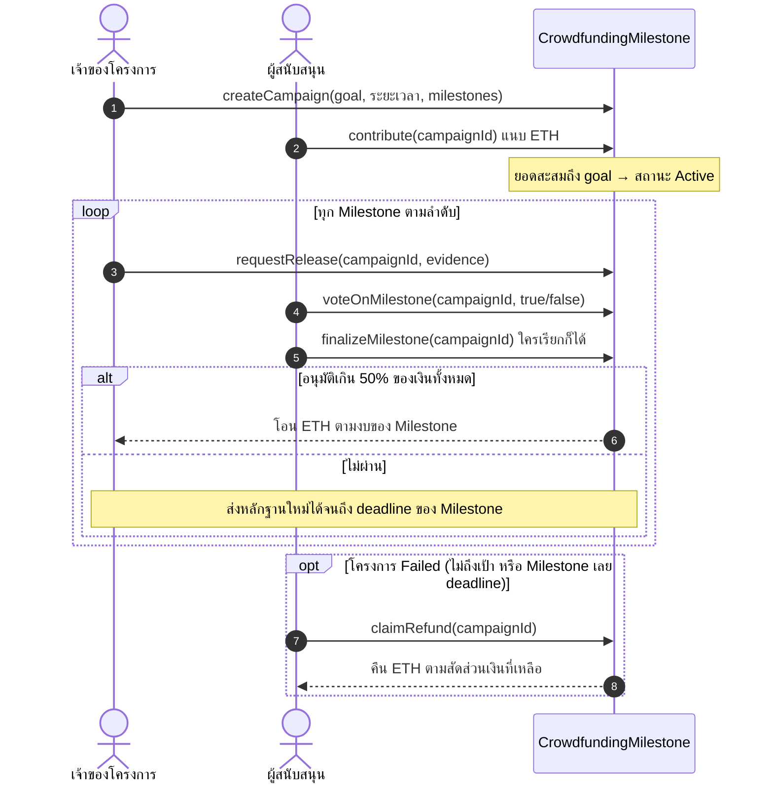
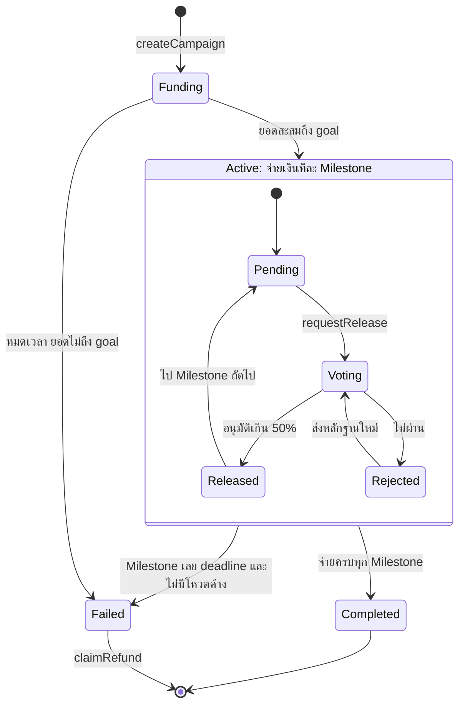

# โจทย์ที่ 5 ระบบบริหารโครงการระดมทุนและจ่ายเงินตามความสำเร็จ

Blockchain Crowdfunding & Milestone Fund Management

## สถานการณ์ทางธุรกิจ (Business Scenario)

บริษัท InnovateFund เป็นแพลตฟอร์มสนับสนุนการระดมทุนสำหรับโครงการนวัตกรรมและธุรกิจ Startup เช่น โครงการพัฒนาอุปกรณ์ IoT ระบบ AI และโซลูชันเพื่อสังคม บริษัทพบว่าผู้สนับสนุนเงินทุนกังวลว่าเจ้าของโครงการอาจนำเงินไปใช้ผิดวัตถุประสงค์ หรือไม่ดำเนินงานตามแผนที่เสนอไว้ ทำให้ผู้ลงทุนขาดความเชื่อมั่น บริษัทจึงต้องการพัฒนาระบบ Crowdfunding บน Ethereum ที่สามารถเก็บเงินทุนไว้ใน Smart Contract และทยอยจ่ายให้เจ้าของโครงการตามความสำเร็จของแต่ละระยะงาน (Milestone)

## ฟังก์ชันที่ต้องการ (Functional Requirements)

1. สร้างโครงการระดมทุน (Create Campaign) เจ้าของโครงการระบุชื่อโครงการ เป้าหมายเงินทุน ระยะเวลาระดมทุน และรายละเอียดของแต่ละ Milestone
2. สนับสนุนเงินทุน (Contribute Funds) ผู้สนับสนุนสามารถเชื่อมต่อ Wallet และโอน ETH เพื่อสนับสนุนโครงการ
3. ตรวจสอบยอดระดมทุน (Track Funding Progress) ระบบแสดงยอดเงินสะสม เป้าหมายเงินทุน และเวลาที่เหลือ
4. ขอเบิกเงินตาม Milestone (Request Fund Release) เจ้าของโครงการส่งหลักฐานความสำเร็จของแต่ละระยะงานเพื่อขอเบิกเงิน
5. อนุมัติการจ่ายเงิน (Approve Milestone) ผู้สนับสนุนลงคะแนนอนุมัติการจ่ายเงินตามเกณฑ์ที่กำหนด และระบบจ่ายเงินเมื่อผ่านเงื่อนไข
6. คืนเงินกรณีไม่สำเร็จ (Refund Contribution) เมื่อหมดระยะเวลาระดมทุนและไม่ถึงเป้าหมาย ผู้สนับสนุนสามารถขอรับเงินคืนตามยอดที่ตนสนับสนุน
7. แสดงความโปร่งใสทางการเงิน (Funding Transparency Dashboard) แสดงประวัติเงินเข้า เงินออก และสถานะของแต่ละ Milestone

**กฎทางธุรกิจสำคัญ:** เจ้าของโครงการไม่สามารถถอนเงินได้ตามอำเภอใจ ต้องผ่านเงื่อนไขการอนุมัติ และยอดเงินที่จ่ายต้องไม่เกินเงินทุนที่จัดสรรไว้

**ผลลัพธ์ที่คาดหวัง:** ระบบระดมทุนที่เพิ่มความมั่นใจให้ผู้สนับสนุน และทำให้การเบิกจ่ายเงินสอดคล้องกับความก้าวหน้าของโครงการ

---

ข้อความโจทย์คัดมาจาก `question/โจทย์ที่ 5 ระบบบริหารโครงการระดมทุนและจ่ายเงินตามความสำเร็จ.pdf` ทุกคำ ยกเว้นรูปประกอบ ไฟล์ PDF อยู่ในเครื่องเท่านั้น ไม่ได้ขึ้น git

## Smart Contract

ไฟล์ [`contracts/CrowdfundingMilestone.sol`](contracts/CrowdfundingMilestone.sol) (Solidity `^0.8.24`) contract ตัวเดียวเก็บได้หลายโครงการ อ้างอิงแต่ละโครงการด้วย `campaignId` ซึ่งเริ่มที่ 1

### โครงสร้างโฟลเดอร์

```text
05-crowdfunding-milestone/
├── contracts/
│   ├── CrowdfundingMilestone.sol   ← Smart Contract หลัก (ไฟล์ที่ deploy)
│   └── test/RefundAttacker.sol     ← ใช้ใน test reentrancy เท่านั้น ห้าม deploy
├── tests/CrowdfundingMilestone.test.js   ← unit test 28 กรณี (Hardhat)
├── scripts/
│   ├── deploy.js                   ← deploy ขึ้น Hardhat node ในเครื่อง
│   └── export-abi.js               ← คัด ABI ไปให้หน้าเว็บหลังแก้ contract
├── frontend/                       ← หน้าเว็บ dApp (HTML + JavaScript ไม่ต้อง build)
├── hardhat.config.js
└── package.json
```

### Contract ทำงานอย่างไร



### ฟังก์ชันตามข้อกำหนด

| ข้อ | ฟังก์ชัน | ใครเรียก |
| --- | --- | --- |
| 1 Create Campaign | `createCampaign(title, description, goal, fundingDuration, votingPeriod, milestoneInputs)` | เจ้าของโครงการ |
| 2 Contribute Funds | `contribute(campaignId)` แนบ ETH | ผู้สนับสนุน |
| 3 Track Funding Progress | `getFundingProgress(campaignId)` คืนยอดสะสม เป้าหมาย เวลาที่เหลือ (วินาที) จำนวนผู้สนับสนุน | ทุกคน |
| 4 Request Fund Release | `requestRelease(campaignId, evidence)` ส่งหลักฐาน เช่น URL หรือ IPFS CID แล้วเปิดโหวต | เจ้าของโครงการ |
| 5 Approve Milestone | `voteOnMilestone(campaignId, approve)` แล้ว `finalizeMilestone(campaignId)` | ผู้สนับสนุนโหวต / ใครก็ได้ปิดโหวต |
| 6 Refund Contribution | `claimRefund(campaignId)` ดูยอดก่อนได้ด้วย `getRefundAmount` | ผู้สนับสนุน |
| 7 Transparency Dashboard | `getCampaign`, `getMilestones`, `hasVoted` และ event `Contributed` / `MilestoneReleased` / `Refunded` เป็นประวัติเงินเข้าออก | ทุกคน |

`currentTime()` คืน `block.timestamp` ให้หน้าเว็บใช้นับเวลาถอยหลังด้วยนาฬิกาเดียวกับที่ contract ใช้ตัดสิน เพราะนาฬิกาในเครื่องผู้ใช้อาจไม่ตรงกับเวลาบน chain

### กฎทางธุรกิจถูกบังคับอย่างไร

- **เจ้าของถอนเงินเองไม่ได้** ไม่มีฟังก์ชัน withdraw เลย เงินออกจาก contract ได้แค่ 2 ทาง คือจ่ายเจ้าของเมื่อ Milestone ผ่านโหวต หรือคืนผู้สนับสนุน
- **จ่ายไม่เกินเงินที่จัดสรร** งบของ Milestone ต้องรวมกันเท่ากับ `goal` พอดี และรับเงินได้ไม่เกิน `goal` ยอดจ่ายรวมจึงไม่มีทางเกินเงินที่ระดมได้
- **เกณฑ์โหวต** น้ำหนักโหวตเท่ากับจำนวน ETH ที่สนับสนุน ต้องมีผู้อนุมัติ **มากกว่า 50% ของเงินทั้งหมด** ถ้าผลชัดแล้ว ปิดโหวตได้ก่อนหมดเวลา ถ้าไม่ผ่าน เจ้าของส่งหลักฐานใหม่ได้จนถึง deadline ของ Milestone นั้น
- **เจ้าของโครงการสนับสนุนโครงการตัวเองไม่ได้** ไม่อย่างนั้นจะใช้เงินตัวเองโหวตอนุมัติ Milestone ของตัวเองได้
- **คืนเงิน** ถ้าระดมไม่ถึงเป้าภายในเวลา ได้คืนเต็มจำนวน ถ้าโครงการล้มกลางทางเพราะ Milestone เลย deadline ได้คืนตามสัดส่วนจากเงินที่เหลือ ผู้สนับสนุนกดรับเงินคืนเองทีละคน (pull payment) ไม่ใช้ loop โอนให้ทุกคน
- ฟังก์ชันที่โอน ETH ใช้ checks-effects-interactions คืออัปเดต state ก่อนโอน และมี `nonReentrant` กัน reentrancy อีกชั้น

### สถานะโครงการ



กล่อง Active ข้างในคือสถานะของ Milestone ปัจจุบัน (`MilestoneStatus`) ส่วนกล่องนอกคือสถานะของโครงการ (`CampaignStatus`)

สถานะคำนวณจากข้อมูลกับเวลาปัจจุบัน ไม่ต้องมีใครส่ง transaction เพื่อเปลี่ยนสถานะเมื่อถึงเวลา deadline ของ Milestone นับต่อกัน ข้อแรกนับจากวันปิดระดมทุน ข้อต่อไปนับจาก deadline ข้อก่อนหน้า

### ทดลองใน Remix (Remix VM)

1. Compile ด้วย 0.8.24 ขึ้นไป แล้ว Deploy ด้วย Account 1 ซึ่งจะเป็นเจ้าของโครงการ
2. `createCampaign` ใช้ระยะเวลาสั้นๆ เพื่อทดลอง
   - `title`: `Smart Farm IoT`, `description`: `Sensor kit`
   - `goal`: `3000000000000000000` (3 ETH)
   - `fundingDuration`: `120`, `votingPeriod`: `60`
   - `milestoneInputs`: `[["Prototype","1000000000000000000","600"],["Production","2000000000000000000","600"]]`
3. สลับไป Account 2 และ 3 ใส่ VALUE คนละ `1.5` Ether แล้วเรียก `contribute(1)` สถานะจะเปลี่ยนเป็น Active (`getCampaignStatus` = 2)
4. Account 1 เรียก `requestRelease(1, "ipfs://proof-1")`
5. Account 2 เรียก `voteOnMilestone(1, true)` ได้ 50% ยังไม่ผ่าน จากนั้น Account 3 เรียกแบบเดียวกันได้ 100%
6. เรียก `finalizeMilestone(1)` Account 1 จะได้รับ 1 ETH ดูผลได้ใน `getMilestones(1)`
7. ทดลองคืนเงิน: สร้างโครงการใหม่โดยตั้ง `fundingDuration` = `60` สนับสนุนไม่ถึงเป้า รอเกิน 60 วินาที แล้วเรียก `claimRefund(2)`

## รัน Test

ต้องมี Node.js 18 ขึ้นไป รันในโฟลเดอร์ `05-crowdfunding-milestone`

```bash
npm install
```

```bash
npm test
```

test ครอบคลุมทั้ง 7 ข้อ กฎทางธุรกิจทุกข้อ การหมดเวลา และการโจมตีแบบ reentrancy ด้วย contract `RefundAttacker`

## หน้าเว็บ (dApp)

โฟลเดอร์ [`frontend/`](frontend/) เป็นหน้าเว็บที่เชื่อม MetaMask ใช้ [ethers.js v6](https://docs.ethers.org/v6/) จาก CDN จึงไม่ต้อง build ทำได้ครบทั้ง 7 ข้อ

| ข้อ | ในหน้าเว็บ |
| --- | --- |
| 1 | ฟอร์ม "สร้างโครงการ" เพิ่ม/ลบ Milestone ได้ และเช็คว่างบรวมเท่ากับเป้าหมายก่อนส่ง |
| 2 | ปุ่ม "เชื่อมต่อ Wallet" และช่อง "สนับสนุน" |
| 3 | แถบความคืบหน้า ยอดสะสม เป้าหมาย และนับเวลาถอยหลัง |
| 4 | เจ้าของโครงการส่งหลักฐาน (URL หรือ `ipfs://`) เพื่อเปิดโหวต |
| 5 | ปุ่มอนุมัติ/ไม่อนุมัติ แถบผลโหวตพร้อมเส้น 50% และปุ่มปิดโหวต |
| 6 | แสดงยอดที่ขอคืนได้และปุ่ม "ขอรับเงินคืน" |
| 7 | ตาราง Milestone, ยอดเงินเข้า/จ่าย/คืน/คงเหลือ และประวัติจาก event พร้อมลิงก์ Etherscan |

ปุ่มที่แสดงจะเปลี่ยนตามบทบาทของ Wallet ที่เชื่อมอยู่ (เจ้าของ / ผู้สนับสนุน / ผู้ชม) และสถานะโครงการ ถ้า contract ปฏิเสธรายการ หน้าเว็บจะแปล custom error เป็นข้อความภาษาไทย ข้อความทุกอย่างที่มาจาก blockchain ถูก escape ก่อนแสดง เพราะใครก็เขียนชื่อโครงการหรือหลักฐานเป็นโค้ดอันตรายได้

### ใช้กับ Sepolia testnet (แนะนำสำหรับนำเสนอ)

1. ติดตั้ง MetaMask เลือกเครือข่าย Sepolia และขอ Sepolia ETH จาก faucet
2. เปิด [Remix](https://remix.ethereum.org) compile `CrowdfundingMilestone.sol` ด้วย 0.8.24
3. ที่ Deploy เลือก Environment เป็น **Injected Provider - MetaMask** แล้ว Deploy
4. คัด address ของ contract และเลข block ที่ deploy (ดูได้จาก Etherscan)
5. เปิดหน้าเว็บด้วย static server ในโฟลเดอร์ `05-crowdfunding-milestone`

   ```bash
   npm run frontend
   ```

6. เปิด `http://localhost:8080` ใส่ address และบล็อกที่ deploy แล้วกด "โหลด" หรือใส่ค่าไว้ใน [`frontend/config.js`](frontend/config.js) ให้โหลดเองทุกครั้ง

หน้าเว็บต้องเปิดผ่าน `http://` เพราะ MetaMask ไม่ทำงานกับไฟล์ที่เปิดแบบ `file://` จะใช้ VS Code Live Server แทน `npm run frontend` ก็ได้ ทดลองหลายบทบาทได้โดยสร้างหลาย Account ใน MetaMask แล้วสลับไปมา

### ใช้กับ Hardhat node ในเครื่อง

```bash
npm run node
```

เปิดอีก terminal แล้วรัน 2 คำสั่งนี้

```bash
npm run deploy:local
```

```bash
npm run frontend
```

`deploy:local` จะพิมพ์ลิงก์ที่มี address ใส่ไว้แล้ว ใน MetaMask ให้เพิ่มเครือข่าย `http://127.0.0.1:8545` (Chain ID 31337) แล้ว import private key ของ account ทดสอบที่ `npm run node` พิมพ์ออกมา key พวกนี้ทุกคนรู้ ห้ามใช้กับเงินจริง

### แก้ contract แล้วต้องทำอะไรต่อ

ABI ใน `frontend/abi.js` สร้างจาก contract ถ้าแก้ฟังก์ชันหรือ event ให้รันคำสั่งนี้ แล้ว deploy ใหม่

```bash
npm run compile && npm run abi
```
